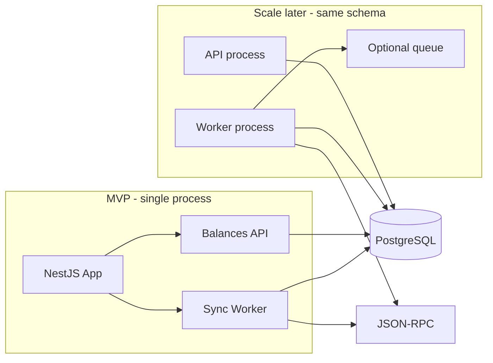
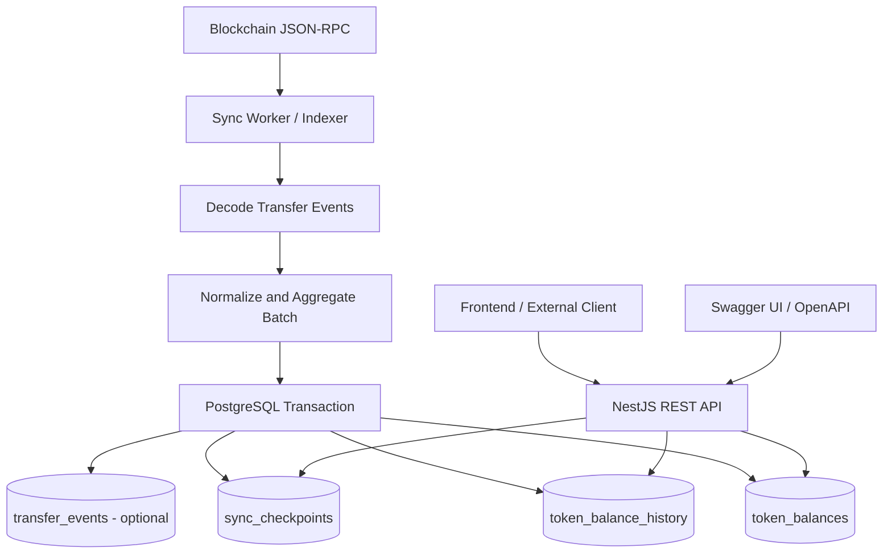

# ERC-20 Holder Balance Indexer

## 1. Overview

### Goal

Build a service that syncs ERC-20 holder balances (for example USDC) from the blockchain into PostgreSQL, with a Swagger API to query:

- The current balance of an address.
- Balance-change history for each `Transfer` event.
- Transaction and block details, plus the balance increase or decrease.
- Sync progress for each token.

**Principle:** ship an MVP in about 3 days, but design the seams up front so the system can scale later (more tokens/chains, a separate worker, higher throughput) without rewriting the schema or the core sync flow.

### Technology (locked in)

- **Backend:** NestJS + TypeScript
- **Database:** PostgreSQL
- **ORM:** TypeORM + migrations (`synchronize: false`)
- **API docs:** Swagger / OpenAPI (`@nestjs/swagger`)
- **Blockchain:** `viem` + EVM JSON-RPC

### Scope by phase

| | Within 3 days (MVP) | Later scale (seams already in place) |
| --- | --- | --- |
| Chain / token | 1 chain + 1 token (seeded via env) | Many tokens / many chains via the `tokens` table |
| Process | API + worker in one NestJS process | Separate worker process / queue, same DB schema |
| Reorg | Sync only up to `head - confirmationDepth` | Rollback/replay by `block_hash` |
| Raw events | Not required | Add `transfer_events` when audit/replay is needed |
| Pagination | `limit` + a simple cursor | Stable keyset pagination when history is large |
| Partition | None | Partition history by block/time when it is large enough |

> Note: not every ERC-20 token yields a correct balance from `Transfer` events alone. Rebasing tokens and tokens with special balance rules need their own reconciliation (Phase 2+).

---

## 1.1. Scale-ready principles (apply from the MVP)

Get these right from the start; **do not** build all of Phase 2/3 in the 3 days:

1. **Multi-dimensional schema:** every main table is keyed by `(chain_id, token_address, ...)`. The MVP seeds one token, but the schema is already multi-token / multi-chain.
2. **Clear module boundaries:** `blockchain` (RPC) / `sync` (indexer) / `balances` (read API) / `tokens` (metadata). Splitting the worker later means enabling the `sync` module in another process, without touching the API.
3. **Idempotent write path:** a unique key per event, and apply the balance exactly once inside a DB transaction. This is the foundation for safe retries and multi-worker writes later.
4. **Checkpoint per token:** `sync_checkpoints` keyed by `(chain_id, token_address)` — scale horizontally by token without a shared checkpoint.
5. **NUMERIC + string API:** avoid a precision rewrite when volume grows.
6. **Config via env:** RPC, batch size, confirmation depth, poll interval — tune throughput without changing code.
7. **API reads the DB only:** do not call RPC on the hot path; adding a cache or read replica later does not break the contract.
8. **Process feature flag:** `SYNC_ENABLED=true|false` so the same codebase can run API-only or worker-only.

**Intentionally out of the MVP (avoid over-engineering):** a queue (Bull/Kafka), a distributed lock, partitioning, complex multi-RPC failover, a full metrics stack, and top holders unless the brief requires them.

---

## 2. Problem statement

Given an ERC-20 token, for example USDC, build a system that tracks the balance of each holder.

The system must meet these requirements:

1. Read `Transfer` events from the blockchain by block range.
2. Determine the balance change for the sender and the receiver.
3. Store the current balance so the API can query it quickly.
4. Store history so balance changes can be inspected over time.
5. Do not write the same event twice when the worker retries.
6. Do not update a balance twice if a batch is processed again.
7. Store a checkpoint so sync can resume after a service restart.
8. Have a strategy for RPC timeout / rate limit; handle reorgs minimally via `confirmationDepth` (full rollback is Phase 2).
9. Provide a Swagger API for testing and integration.
10. Keep token amounts exact; do not use floating point for on-chain balances.

### Primary queries

**MVP**

- Get the current balance of a holder.
- Get a holder's balance history in time order (`limit` / cursor).
- Get the token's sync progress.
- Get metadata for the token being tracked.

**Later scale / optional**

- Filter history by block range or time range.
- Top holders (`ORDER BY balance DESC` plus a secondary index when needed).
- Admin: add a token / trigger a resync via the API.

---

## 3. System architecture

### 3.0. MVP (1 process) vs scale (split processes)



Same schema + same module boundaries → scale by splitting deploys / toggling `SYNC_ENABLED`, without a redesign.

### 3.1. Data flow



### Components

#### 3.2. Blockchain RPC

- Read blocks and `Transfer` logs by block range.
- Fetch the timestamp and block hash for each event.
- Cap the block range to the provider limit (`SYNC_BLOCK_RANGE`).
- Retry with exponential backoff on transient errors (timeout, 429).
- **Later scale:** add an RPC fallback list / provider pool without changing the `TransferLogReader` contract.

#### 3.3. Sync worker / indexer

The worker:

1. Reads the current checkpoint (per token).
2. Determines the next block range; safe head = `latest - confirmationDepth`.
3. Fetches logs from RPC.
4. Sorts logs by `blockNumber`, `transactionIndex`, `logIndex`.
5. Decodes events and normalizes addresses (lowercase).
6. Computes the delta for each holder.
7. Writes history, updates the current balance, and updates the checkpoint in **one** DB transaction.
8. Marks the range complete only after a successful commit.

MVP: one sequential worker loop over `enabled` tokens. Do not process the same token in parallel until a lock exists.

**Later scale:** one worker process per token / per chain; or a queue job keyed by `(chainId, tokenAddress, fromBlock, toBlock)`.

#### 3.4. PostgreSQL

- `tokens`: metadata + `deployment_block` / start block.
- `token_balances`: current balances.
- `token_balance_history`: per-event history.
- `sync_checkpoints`: sync progress.
- `transfer_events` (Phase 2): raw logs for replay / audit / reorg.

#### 3.5. NestJS API

The API only serves already-synced data; it does not call RPC for ordinary balance reads.

Swagger is served via `@nestjs/swagger` at `/docs`.

---

## 4. Database design

### 4.1. Principles

- Each token: `chain_id + token_address`.
- Each holder: `chain_id + token_address + holder_address`.
- Normalize addresses to lowercase when using `VARCHAR`.
- Store balances as raw integer units; do not divide by `10 ** decimals` in the DB.
- Use `NUMERIC`, not `FLOAT` / `REAL`.
- The API returns raw amounts as strings.
- `decimals` / `symbol` live on the `tokens` table.

### 4.2. Table `tokens`

```sql
CREATE TABLE tokens (
    chain_id          INTEGER NOT NULL,
    token_address     VARCHAR(42) NOT NULL,
    symbol            VARCHAR(32),
    name              VARCHAR(128),
    decimals          SMALLINT,
    deployment_block  BIGINT NOT NULL,
    enabled           BOOLEAN NOT NULL DEFAULT TRUE,
    created_at        TIMESTAMPTZ NOT NULL DEFAULT NOW(),
    updated_at        TIMESTAMPTZ NOT NULL DEFAULT NOW(),

    PRIMARY KEY (chain_id, token_address)
);
```

MVP: seed one row from env at bootstrap. Scale: add tokens via insert / an admin API later.

### 4.3. Table `token_balances`

```sql
CREATE TABLE token_balances (
    chain_id          INTEGER NOT NULL,
    token_address     VARCHAR(42) NOT NULL,
    holder_address    VARCHAR(42) NOT NULL,
    balance           NUMERIC(78, 0) NOT NULL,
    updated_block     BIGINT NOT NULL,
    updated_log_index INTEGER,
    updated_at        TIMESTAMPTZ NOT NULL DEFAULT NOW(),

    PRIMARY KEY (chain_id, token_address, holder_address),
    CHECK (balance >= 0)
);
```

Notes:

- A PK lookup is enough for current-balance reads in the MVP.
- A row may be deleted when the balance is 0; the API treats a missing row as 0. If "every holder that ever appeared" is required, keep the zero-balance row.
- **Scale — top holders:** add this index only when it is actually needed:

```sql
CREATE INDEX idx_token_balances_top
ON token_balances (chain_id, token_address, balance DESC);
```

### 4.4. Table `token_balance_history`

One `Transfer` usually creates at most two rows (sender + receiver). Mint/burn against the zero address has its own rules.

```sql
CREATE TABLE token_balance_history (
    id                BIGINT GENERATED ALWAYS AS IDENTITY PRIMARY KEY,
    chain_id          INTEGER NOT NULL,
    token_address     VARCHAR(42) NOT NULL,
    holder_address    VARCHAR(42) NOT NULL,

    block_number      BIGINT NOT NULL,
    block_hash        VARCHAR(66) NOT NULL,
    block_timestamp   TIMESTAMPTZ NOT NULL,
    transaction_index INTEGER NOT NULL,
    tx_hash           VARCHAR(66) NOT NULL,
    log_index         INTEGER NOT NULL,

    balance_before    NUMERIC(78, 0) NOT NULL,
    balance_after     NUMERIC(78, 0) NOT NULL,
    delta             NUMERIC(80, 0) NOT NULL,

    created_at        TIMESTAMPTZ NOT NULL DEFAULT NOW(),

    UNIQUE (chain_id, tx_hash, log_index, holder_address)
);
```

```sql
CREATE INDEX idx_balance_history_holder_order
ON token_balance_history (
    chain_id,
    token_address,
    holder_address,
    block_number DESC,
    transaction_index DESC,
    log_index DESC
);

-- Optional when querying or handling reorgs by block
CREATE INDEX idx_balance_history_block
ON token_balance_history (
    chain_id,
    token_address,
    block_number
);
```

`delta` uses `NUMERIC(80,0)` so a signed difference near the `uint256` limit stays safe.

### 4.5. Table `sync_checkpoints`

```sql
CREATE TABLE sync_checkpoints (
    chain_id             INTEGER NOT NULL,
    token_address        VARCHAR(42) NOT NULL,
    last_processed_block BIGINT NOT NULL,
    last_block_hash      VARCHAR(66),
    updated_at           TIMESTAMPTZ NOT NULL DEFAULT NOW(),

    PRIMARY KEY (chain_id, token_address)
);
```

Do not advance the checkpoint before the balance and history commit succeeds.

### 4.6. Table `transfer_events` (Phase 2 — optional)

Enable this when replay, audit, or easier reorg handling is needed. **Not required for the MVP.**

```sql
CREATE TABLE transfer_events (
    chain_id          INTEGER NOT NULL,
    token_address     VARCHAR(42) NOT NULL,
    block_number      BIGINT NOT NULL,
    block_hash        VARCHAR(66) NOT NULL,
    transaction_index INTEGER NOT NULL,
    tx_hash           VARCHAR(66) NOT NULL,
    log_index         INTEGER NOT NULL,
    from_address      VARCHAR(42) NOT NULL,
    to_address        VARCHAR(42) NOT NULL,
    value             NUMERIC(78, 0) NOT NULL,
    created_at        TIMESTAMPTZ NOT NULL DEFAULT NOW(),

    PRIMARY KEY (chain_id, tx_hash, log_index)
);

CREATE INDEX idx_transfer_events_block
ON transfer_events (chain_id, token_address, block_number);
```

---

## 5. Transfer event processing

Example: `Transfer(A, B, 100)` where A=500 and B=200 before the event:

- A: before=500, delta=-100, after=400
- B: before=200, delta=+100, after=300

### Processing one block range

1. Fetch logs in `[from, to]`, with `to <= latest - confirmationDepth`.
2. Sort by `block_number`, `transaction_index`, `log_index`.
3. Decode the event.
4. Identify sender / receiver (mint / burn / self-transfer).
5. Read the current balance of each affected holder (inside the transaction; `SELECT ... FOR UPDATE` when scaling to multiple writers).
6. Compute `balance_before`, `delta`, `balance_after`.
7. Insert history (`ON CONFLICT DO NOTHING` / fail-and-skip if the row already exists — keep the idempotency rule explicit).
8. Update the current balance **only when** the history row is newly written.
9. Update the checkpoint and `last_block_hash`.
10. Commit.

### Duplicate protection and retries

A unique constraint on history **is not enough** if a conflict still increments the balance. Pick one rule and keep it everywhere:

- Insert history first; apply the balance only when the insert succeeds (a new row).
- Or write a unique raw event first (Phase 2), then apply the balance only for new events.

A failed batch → roll back the whole transaction → retry. Do not commit the checkpoint early.

### Edge cases

- Mint: `from` is the zero address.
- Burn: `to` is the zero address.
- Self-transfer: net delta is 0; avoid a bad double-apply.
- Several transfers for the same holder in one block: preserve log order; history stays event-level.
- Reorg (MVP): avoid it with `confirmationDepth`. Phase 2: compare `block_hash`, roll back from the diverging block, then replay.

---

## 6. Read/write optimization

### Read: current balance

```sql
SELECT balance, updated_block
FROM token_balances
WHERE chain_id = $1
  AND token_address = LOWER($2)
  AND holder_address = LOWER($3);
```

### Read: history

```sql
SELECT
    block_number,
    block_timestamp,
    tx_hash,
    log_index,
    balance_before,
    balance_after,
    delta
FROM token_balance_history
WHERE chain_id = $1
  AND token_address = LOWER($2)
  AND holder_address = LOWER($3)
ORDER BY block_number DESC, transaction_index DESC, log_index DESC
LIMIT $4;
```

MVP: a simple cursor based on `(block_number, transaction_index, log_index)`. Scale: keyset pagination; avoid a large `OFFSET`.

### Write

- Batch a few hundred to a few thousand logs; tune with `SYNC_BLOCK_RANGE`.
- Bulk-insert history.
- Aggregate deltas for the current balance in the batch **after** history has been written in the correct order.
- MVP: one sequential worker. Scale: limit concurrency per token and use row locks.

### Partitioning

Not needed at the start. When history is very large, partition by block or time; design the unique constraint so it is compatible with the partition key.

---

## 7. NestJS project structure

```text
src/
├── app.module.ts
├── main.ts
├── config/
│   ├── configuration.ts
│   └── validation.ts
├── database/
│   ├── database.module.ts
│   └── migrations/
├── blockchain/
│   ├── blockchain.module.ts
│   ├── rpc.client.ts
│   ├── transfer-log.reader.ts
│   └── abi/
│       └── erc20.abi.ts
├── tokens/
│   ├── tokens.module.ts
│   ├── tokens.controller.ts
│   ├── tokens.service.ts
│   ├── dto/
│   └── entities/
│       └── token.entity.ts
├── balances/
│   ├── balances.module.ts
│   ├── balances.controller.ts
│   ├── balances.service.ts
│   ├── dto/
│   └── entities/
│       ├── token-balance.entity.ts
│       └── token-balance-history.entity.ts
├── sync/
│   ├── sync.module.ts
│   ├── sync.service.ts
│   ├── sync.worker.ts
│   ├── checkpoint.service.ts
│   └── dto/
└── common/
    ├── filters/
    ├── interceptors/
    ├── pipes/
    └── utils/
```

### Module responsibilities

| Module | MVP | Scale path |
| --- | --- | --- |
| `blockchain` | 1 RPC client | Provider pool / failover |
| `sync` | Loop in the same process (`SYNC_ENABLED`) | Separate process / queue jobs |
| `tokens` | Seed 1 token from env | CRUD for many tokens |
| `balances` | Read API | Cache / read replica |
| `database` | Migrations | Partition / connection-pool tuning |

Do not enable `synchronize: true` in a real environment.

### Suggested bootstrap

- `SYNC_ENABLED=true`: start the worker after the app is listening.
- `SYNC_ENABLED=false`: API-only (ready to scale reads horizontally).

---

## 8. Swagger REST API

Base path: `/api/v1`

| Method | Endpoint | MVP | Notes |
| --- | --- | --- | --- |
| `GET` | `/health` | Yes | Liveness |
| `GET` | `/tokens` | Yes | Token list |
| `GET` | `/tokens/:chainId/:tokenAddress` | Yes | Metadata |
| `GET` | `/tokens/:chainId/:tokenAddress/holders/:holderAddress/balance` | Yes | Current balance |
| `GET` | `/tokens/:chainId/:tokenAddress/holders/:holderAddress/history` | Yes | History + cursor |
| `GET` | `/tokens/:chainId/:tokenAddress/sync-status` | Yes | Checkpoint / lag |
| `GET` | `/tokens/:chainId/:tokenAddress/holders/top` | Optional | Scale / if the brief requires it |
| `POST` | `/tokens` | Optional | Admin: add a token |
| `POST` | `/tokens/:chainId/:tokenAddress/sync` | Optional | Admin: resync |

### Example: current balance

```json
{
  "chainId": 1,
  "tokenAddress": "0xTOKEN",
  "holderAddress": "0xAAA",
  "balanceRaw": "1500000",
  "decimals": 6,
  "balanceFormatted": "1.5",
  "updatedBlock": "22000000"
}
```

`balanceRaw` and block numbers are returned as strings. `balanceFormatted` uses a decimal-safe formatter.

### Example: history

```json
{
  "items": [
    {
      "blockNumber": "22000000",
      "timestamp": "2026-10-09T12:00:00Z",
      "txHash": "0x...",
      "logIndex": 3,
      "deltaRaw": "500000",
      "balanceBeforeRaw": "1000000",
      "balanceAfterRaw": "1500000"
    }
  ],
  "nextCursor": null
}
```

### Swagger bootstrap

```typescript
import { NestFactory } from '@nestjs/core';
import { SwaggerModule, DocumentBuilder } from '@nestjs/swagger';
import { AppModule } from './app.module';

async function bootstrap() {
  const app = await NestFactory.create(AppModule);

  const config = new DocumentBuilder()
    .setTitle('ERC-20 Balance Indexer API')
    .setDescription(
      'API for current ERC-20 holder balances, balance history, and sync status.',
    )
    .setVersion('1.0.0')
    .addTag('Tokens')
    .addTag('Balances')
    .addTag('Sync')
    .build();

  const document = SwaggerModule.createDocument(app, config);
  SwaggerModule.setup('docs', app, document);

  await app.listen(process.env.PORT ?? 3000);
}

bootstrap();
```

---

## 9. Correctness guarantees

### Event order

Sort by `block_number` → `transaction_index` → `log_index`.

### Safe sync

- **MVP:** index only up to `head - SYNC_CONFIRMATION_DEPTH`; store `last_block_hash`.
- **Phase 2:** if the hash at the checkpoint is no longer canonical → roll back from the diverging block → replay.
- Write balance, history, and checkpoint in the same transaction.

### Reconciliation (Phase 2)

Periodically compare a sample of holders against `balanceOf(holder)` at a confirmed block. The holder list comes from events/the DB, not from `balanceOf`.

---

## 10. Environment configuration

Design env so the MVP runs immediately and scale happens by adding variables or splitting processes, without a schema change.

```dotenv
# App
NODE_ENV=development
PORT=3000

# Process role — scale: API replicas set SYNC_ENABLED=false
SYNC_ENABLED=true

# PostgreSQL
DATABASE_HOST=localhost
DATABASE_PORT=5432
DATABASE_USER=postgres
DATABASE_PASSWORD=postgres
DATABASE_NAME=indexer

# RPC (viem)
RPC_URL=https://eth-mainnet.g.alchemy.com/v2/YOUR_KEY
# Later scale (optional):
# RPC_URL_FALLBACK=https://...

# MVP token seed (1 token). Scale: insert more rows into the tokens table
CHAIN_ID=1
TOKEN_ADDRESS=0xa0b86991c6218b36c1d19d4a2e9eb0ce3606eb48
TOKEN_SYMBOL=USDC
TOKEN_NAME=USD Coin
TOKEN_DECIMALS=6
# Use a recent block for a timely demo; production: a verified deployment/start block
SYNC_START_BLOCK=22000000

# Sync tuning — raise or lower to scale throughput
SYNC_BLOCK_RANGE=500
SYNC_CONFIRMATION_DEPTH=12
SYNC_POLL_INTERVAL_MS=5000
SYNC_RETRY_MAX_ATTEMPTS=5
SYNC_RETRY_BASE_DELAY_MS=1000
```

| Variable | Required for MVP | Purpose |
| --- | --- | --- |
| `DATABASE_*` | Yes | Postgres |
| `RPC_URL` | Yes | `eth_getLogs` / blocks |
| `CHAIN_ID`, `TOKEN_*`, `SYNC_START_BLOCK` | Yes | Seed 1 token |
| `SYNC_BLOCK_RANGE` | Yes | Batch size |
| `SYNC_CONFIRMATION_DEPTH` | Yes | Reduce MVP reorg exposure |
| `SYNC_POLL_INTERVAL_MS` | Yes | Poll once caught up to head |
| `SYNC_ENABLED` | Recommended | Split API / worker later |
| `SYNC_RETRY_*` | Recommended | RPC backoff |
| `RPC_URL_FALLBACK` | No | Scale reliability |

Do not commit a `.env` that contains secrets. Validate env at boot (`Joi` / `zod` / `class-validator`).

**3-day demo note:** do not set `SYNC_START_BLOCK` too far behind head on mainnet (USDC from genesis will take a very long time to sync). Pick a window of a few thousand to a few tens of thousands of blocks, or use Anvil plus a local token.

---

## 11. Testing

### MVP (priority)

1. Decode an ERC-20 `Transfer` correctly.
2. Subtract from the sender and add to the receiver correctly.
3. Mint, burn, and self-transfer.
4. Several events for the same holder in one block.
5. Retrying the same batch does not double-apply the balance.
6. The DB rolls back when a batch fails partway through.
7. The checkpoint advances only after commit.
8. The history API returns the correct order and precision (large numbers as strings).

### Phase 2+

9. Reorg detection + replay.
10. Reconciliation against `balanceOf()`.
11. Independent checkpoints for multiple tokens.
12. An API-only process with `SYNC_ENABLED=false`.

---

## 12. 3-day plan and the scale path

### Day 1 — Foundation

- NestJS + TypeORM + Postgres (Docker Compose).
- Migrations: `tokens`, `token_balances`, `token_balance_history`, `sync_checkpoints`.
- Config/env validation + seed 1 token.
- `blockchain`: RPC client + read `Transfer` logs by range.

### Day 2 — Correct sync

- Worker: checkpoint → fetch → decode → idempotent apply inside a transaction.
- Handle mint/burn/self-transfer + retry backoff.
- `confirmationDepth` safe head.
- Keep it simple: sync a recent block window so there is demo data.

### Day 3 — API and polish

- Balance / history / sync-status / tokens + Swagger.
- `GET /health`.
- Core test cases + a README for running locally.
- (Optional if time remains) Top holders or `transfer_events`.

### Phase 2 — Reliability (after the brief)

- `transfer_events` + reorg rollback/replay.
- `balanceOf` reconciliation.
- Structured logs / metrics / lag alerts.
- A worker lock per token.

### Phase 3 — Scale

- Use `SYNC_ENABLED` to split API and worker deploys.
- A queue by block range / a per-token worker.
- Benchmark batch size; tune the connection pool.
- Strict keyset pagination; partition history when it is large enough.
- Multi-RPC fallback; multiple chains.

---

## 13. Default architecture decisions

| Item | MVP (3 days) | Scale path |
| --- | --- | --- |
| Backend | NestJS monolith (API + worker) | Split processes, same codebase |
| Database | PostgreSQL | Read replica / partition later |
| ORM | TypeORM + migrations | Unchanged |
| Chain lib | `viem` | Provider pool |
| Current balance | `token_balances` | + top-holders index if needed |
| History | Event-level `token_balance_history` | Partition / retention |
| Sync progress | `sync_checkpoints` per token | Multi-worker per token |
| Raw events | Skip | `transfer_events` |
| Write | Batch + TX + idempotency | Queue + lock |
| Read | PK lookup + holder index | Cache / replica |
| Pagination | Limit + simple cursor | Keyset |
| Precision | `NUMERIC` + string API | Unchanged |
| Reorg | `confirmationDepth` | Hash check + rollback |
| Deploy | Docker Compose | API replicas + worker replicas |

**Conclusion:** In 3 days, implement 1 process + 1 token + 4 core tables, but **keep the `(chain_id, token_address)` key, separated modules, idempotent writes, a per-token checkpoint, and `SYNC_ENABLED`**. That is the shortest path to a correct demo, and it still leaves room to add tokens, split the worker, and raise throughput without a redesign.
