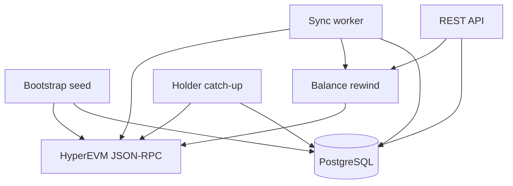

# ERC-20 Holder Balance Indexer

NestJS service that indexes one HyperEVM ERC-20 into PostgreSQL and exposes a Swagger API for confirmed balances, transfer history, and sync progress.

This document describes the system as it runs. Operational steps live in [README.md](README.md).

## 1. Scope


| In place                                             | Deferred                                        |
| ---------------------------------------------------- | ----------------------------------------------- |
| More tokens and chains through the same keys         |                                                 |
| API, sync worker, and holder catch-up in one process | Separate worker process or a queue, same schema |
| Reorg exposure limited by `confirmationDepth`        |                                                 |
| Event-level `token_balance_history`                  | Raw `transfer_events` for audit and replay      |
| Keyset history cursor                                | Partitioning when history is large              |
| RPC fallback list in `chain_rpc_endpoints`           | Admin APIs to add a token or trigger a resync   |


Not every ERC-20 balance can be rebuilt from `Transfer` alone. Rebasing tokens and tokens with custom balance rules need their own reconciliation.

## 2. HyperEVM constraints

These constraints decide the read path. They are not optional optimizations.

- `balanceOf(holder)` is reliable only at the current head. The same call at any older block returns 0.
- A confirmed balance is `balanceOf(head)` minus the net `Transfer` delta after `head - SYNC_CONFIRMATION_DEPTH`.
- `eth_getLogs` rejects a range wider than 1000 blocks. `TransferLogReader` chunks inside that cap. Prefer `SYNC_BLOCK_RANGE` at or below 100, because the provider also rate-limits.
- Far-history block heights are rejected. The seed start block is estimated from recent block time, then adjusted to the nearest block the RPC will serve.
- The rewind delta cache in `BalanceRewindService` lives in the process. Another replica does not see it.

The balance endpoint therefore calls RPC. History after the first response is filled from the database by a background catch-up. Do not "fix" the balance route back to a database-only read.

## 3. Principles that still hold

1. Every balance, history, and checkpoint row is keyed by `(chain_id, token_address, ...)`.
2. `blockchain` talks to RPC. `sync` indexes forward. `balances` serves reads and catch-up. `tokens` and `chains` own metadata.
3. A history row is written once. The balance moves only for a new history row. Checkpoint, history, and balance commit in one transaction.
4. Amounts are `NUMERIC`, never float. The API returns them as strings.
5. `SYNC_ENABLED=false` runs the API without the forward indexer.
6. Schema changes go through migrations. `synchronize` stays off. See [schema source of truth](#14-schema-source-of-truth).


## 4. Runtime




One NestJS process boots in this order:

1. Migrations run.
2. If `chains` is empty, seed HyperEVM from `CHAIN_ID`, `CHAIN_NAME`, and `HYPEREVM_RPC_URL`. Fallback URLs are written to `chain_rpc_endpoints`.
3. If `tokens` is empty, read `name`, `symbol`, and `decimals` on-chain, estimate the start block as now minus `SYNC_LOOKBACK_DAYS`, then insert the token and a checkpoint at that block minus one.
4. When `SYNC_ENABLED=true`, the worker polls enabled tokens.
5. A cron every 10 seconds advances the oldest `holder_sync_tasks` row.

`tokens.chain_id` references `chains.chain_id`. After seed, RPC calls use the URLs stored for that chain. `RpcClientFactory` tries the primary URL, then enabled fallbacks. A provider rate-limit (`429`, CU limit, timeout) cools that URL down for 10 seconds and the next URL is tried.

PostgreSQL is external. `docker-compose.yml` runs only the API.

## 5. Balance read

`GET .../balance` does not wait for historical indexing.

1. Load the enabled chain and its RPC URL.
2. Read head `balanceOf`.
3. Subtract holder deltas from `safeHead + 1` through head. `safeHead` is `head - SYNC_CONFIRMATION_DEPTH`.
4. Return that balance with `balanceSource: "confirmed"` and `updatedBlock` set to `safeHead`.
5. Schedule a catch-up so later history requests can be served from the database. The zero address is not scheduled.

Concurrent reads for the same holder share one in-flight rewind.

Empty history returns `message` computed from `DAY_APP_DEPLOY` minus `SYNC_LOOKBACK_DAYS`. That string is a product boundary, not proof that the address never held the token before the lookback.

## 6. Forward sync

For each enabled token the worker:

1. Loads the checkpoint and the chain head.
2. Sets `safeHead = head - confirmationDepth`. The next range starts at `last_processed_block + 1` and is capped by `SYNC_BLOCK_RANGE` and `safeHead`.
3. Fetches and decodes `Transfer` logs. Order is `block_number`, `transaction_index`, `log_index`. Addresses are lowercase.
4. For a holder with no `token_balances` row, rewinds a baseline to the end of the block before the range. That baseline is `balanceOf(head)` minus every `Transfer` after the target block.
5. Inside one database transaction, takes the token write lock, writes history and balances, then advances the checkpoint and `last_block_hash` to the end block.
6. Retries the range with exponential backoff. A failed attempt rolls back, so the checkpoint does not move.

Mint (`from` is the zero address) only credits the receiver. Burn only debits the sender. A self-transfer writes one history row with delta 0. Several transfers for the same holder in one range stay in log order.

A negative balance after the rewound baseline aborts the transaction.

## 7. Holder history catch-up

The balance response is immediate. History for a holder the indexer has not fully covered is filled by `holder_sync_tasks`.


| Column              | Meaning                                                             |
| ------------------- | ------------------------------------------------------------------- |
| `target_block`      | Confirmed head the scan must reach                                  |
| `confirmed_balance` | Balance returned for that target                                    |
| `scan_from_block`   | First block of this attempt. A restart moves `next_block` back here |
| `next_block`        | Next inclusive block to read                                        |
| `start_balance`     | Balance at the end of `scan_from_block - 1`                         |
| `status`            | `pending`, `running`, `done`, or `failed`                           |


Each cron tick takes the oldest `running` task, otherwise the oldest `pending` task, and scans up to 2000 blocks. The log reader still chunks those blocks into RPC ranges of at most 1000. History rows are inserted as each chunk commits. `token_balances` is updated when the scan reaches `target_block`.

The same token write lock used by the forward sync covers these writes.

## 8. Database

Addresses are lowercase `VARCHAR(42)`. Balances are raw integer units. `decimals` lives on `tokens`.

`tokens.deployment_block` is the estimated lookback start, not necessarily the contract creation block.

### 8.1. `chains`

```sql
CREATE TABLE chains (
    chain_id    INTEGER PRIMARY KEY,
    name        VARCHAR(64) NOT NULL,
    rpc_url     TEXT NOT NULL,
    enabled     BOOLEAN NOT NULL DEFAULT TRUE,
    created_at  TIMESTAMPTZ NOT NULL DEFAULT NOW(),
    updated_at  TIMESTAMPTZ NOT NULL DEFAULT NOW()
);
```


### 8.2. `chain_rpc_endpoints`

```sql
CREATE TABLE chain_rpc_endpoints (
    id          SERIAL PRIMARY KEY,
    chain_id    INTEGER NOT NULL REFERENCES chains (chain_id) ON DELETE CASCADE,
    url         TEXT NOT NULL,
    sort_order  INTEGER NOT NULL DEFAULT 0,
    enabled     BOOLEAN NOT NULL DEFAULT TRUE,
    created_at  TIMESTAMPTZ NOT NULL DEFAULT NOW(),
    UNIQUE (chain_id, url)
);
```

Env fallbacks are synced into this table on chain load. URLs removed from env are disabled, not deleted.

### 8.3. `tokens`

```sql
CREATE TABLE tokens (
    chain_id          INTEGER NOT NULL REFERENCES chains (chain_id) ON DELETE RESTRICT,
    token_address     VARCHAR(42) NOT NULL,
    symbol            VARCHAR(32),
    name              VARCHAR(128),
    decimals          SMALLINT,
    deployment_block  BIGINT NOT NULL,
    enabled           BOOLEAN NOT NULL DEFAULT TRUE,
    created_at        TIMESTAMPTZ NOT NULL DEFAULT NOW(),
    updated_at        TIMESTAMPTZ NOT NULL DEFAULT NOW(),
    PRIMARY KEY (chain_id, token_address)
);
```


### 8.4. `token_balances`

```sql
CREATE TABLE token_balances (
    chain_id          INTEGER NOT NULL,
    token_address     VARCHAR(42) NOT NULL,
    holder_address    VARCHAR(42) NOT NULL,
    balance           NUMERIC(78, 0) NOT NULL,
    updated_block     BIGINT NOT NULL,
    updated_log_index INTEGER,
    updated_at        TIMESTAMPTZ NOT NULL DEFAULT NOW(),
    PRIMARY KEY (chain_id, token_address, holder_address),
    CHECK (balance >= 0)
);
```

There is no foreign key to `tokens` yet. Add `REFERENCES tokens (chain_id, token_address) ON DELETE RESTRICT` on this table, `token_balance_history`, `sync_checkpoints`, and `holder_sync_tasks` when a second token makes orphans expensive. A top-holders index on `(chain_id, token_address, balance DESC)` waits until that query exists.

### 8.5. `token_balance_history`

One `Transfer` writes at most two rows. The unique key does not include `token_address`: `log_index` already identifies one log, and one log belongs to one token contract. `holder_address` is required because the sender and receiver are two rows.

```sql
CREATE TABLE token_balance_history (
    id                BIGINT GENERATED ALWAYS AS IDENTITY PRIMARY KEY,
    chain_id          INTEGER NOT NULL,
    token_address     VARCHAR(42) NOT NULL,
    holder_address    VARCHAR(42) NOT NULL,
    block_number      BIGINT NOT NULL,
    block_hash        VARCHAR(66) NOT NULL,
    block_timestamp   TIMESTAMPTZ NOT NULL,
    transaction_index INTEGER NOT NULL,
    tx_hash           VARCHAR(66) NOT NULL,
    log_index         INTEGER NOT NULL,
    balance_before    NUMERIC(78, 0) NOT NULL,
    balance_after     NUMERIC(78, 0) NOT NULL,
    delta             NUMERIC(80, 0) NOT NULL,
    created_at        TIMESTAMPTZ NOT NULL DEFAULT NOW(),
    UNIQUE (chain_id, tx_hash, log_index, holder_address)
);

CREATE INDEX idx_balance_history_holder_order
ON token_balance_history (
    chain_id, token_address, holder_address,
    block_number DESC, transaction_index DESC, log_index DESC
);

CREATE INDEX idx_balance_history_block
ON token_balance_history (chain_id, token_address, block_number);
```

`delta` is `NUMERIC(80,0)` so a signed value near the `uint256` limit still fits.

### 8.6. `sync_checkpoints`

```sql
CREATE TABLE sync_checkpoints (
    chain_id             INTEGER NOT NULL,
    token_address        VARCHAR(42) NOT NULL,
    last_processed_block BIGINT NOT NULL,
    last_block_hash      VARCHAR(66),
    updated_at           TIMESTAMPTZ NOT NULL DEFAULT NOW(),
    PRIMARY KEY (chain_id, token_address)
);
```

The checkpoint moves only in the transaction that wrote the range.

### 8.7. `holder_sync_tasks`

```sql
CREATE TABLE holder_sync_tasks (
    id                SERIAL PRIMARY KEY,
    chain_id          INTEGER NOT NULL,
    token_address     VARCHAR(42) NOT NULL,
    holder_address    VARCHAR(42) NOT NULL,
    target_block      BIGINT NOT NULL,
    confirmed_balance NUMERIC(78, 0) NOT NULL,
    scan_from_block   BIGINT NOT NULL,
    next_block        BIGINT NOT NULL,
    start_balance     NUMERIC(78, 0),
    status            VARCHAR(16) NOT NULL,
    last_error        TEXT,
    created_at        TIMESTAMPTZ NOT NULL DEFAULT NOW(),
    updated_at        TIMESTAMPTZ NOT NULL DEFAULT NOW(),
    UNIQUE (chain_id, token_address, holder_address)
);

CREATE INDEX idx_holder_sync_tasks_status
ON holder_sync_tasks (status, created_at);
```


## 9. Idempotency and locking

Forward sync and holder catch-up both call `pg_advisory_xact_lock(chain_id, hashtext(token_address))` inside the write transaction. The lock disappears when the transaction ends. It serializes the two writers in this process and in any other session on the same database.

For each holder side of a log:

1. If `(chain_id, tx_hash, log_index, holder_address)` already exists, skip that side.
2. Otherwise insert history, then save the new balance.
3. A unique violation rolls the whole transaction back, including the checkpoint.

`SELECT ... FOR UPDATE` on balance rows is the later step if several workers apply different ranges of the same token at once. The advisory lock is enough while one process owns a token.

## 10. API

Base path `/api/v1`. Swagger is mounted at `/docs` from `src/main.ts`.


| Method | Path                                                            | Role                                    |
| ------ | --------------------------------------------------------------- | --------------------------------------- |
| GET    | `/health`                                                       | Liveness. Excluded from the rate limit. |
| GET    | `/api/v1/chains`                                                | List chains                             |
| GET    | `/api/v1/chains/:chainId`                                       | Chain detail                            |
| GET    | `/api/v1/tokens`                                                | List tokens                             |
| GET    | `/api/v1/tokens/:chainId/:tokenAddress`                         | Token metadata                          |
| GET    | `/api/v1/tokens/:chainId/:tokenAddress/holders/:holder/balance` | Confirmed balance                       |
| GET    | `/api/v1/tokens/:chainId/:tokenAddress/holders/:holder/history` | Keyset history                          |
| GET    | `/api/v1/tokens/:chainId/:tokenAddress/sync-status`             | Checkpoint, safe head, lag              |


One rate-limit bucket per client IP covers the API. Over the limit the response is 429 with `Retry-After` and `X-RateLimit-*`. Production sits behind a proxy, so `TRUST_PROXY` must match the number of hops or every caller shares the loopback address.

Balance:

```json
{
  "chainId": 999,
  "tokenAddress": "0xabc...",
  "holderAddress": "0xdef...",
  "balanceRaw": "1500000",
  "decimals": 6,
  "balanceFormatted": "1.5",
  "updatedBlock": "22000000",
  "balanceSource": "confirmed"
}
```

History uses a base64url cursor over `(blockNumber, transactionIndex, logIndex)`, compared with a tuple predicate. There is no `OFFSET`.

```json
{
  "items": [
    {
      "blockNumber": "22000000",
      "timestamp": "2026-10-09T12:00:00.000Z",
      "txHash": "0x...",
      "logIndex": 3,
      "deltaRaw": "500000",
      "balanceBeforeRaw": "1000000",
      "balanceAfterRaw": "1500000"
    }
  ],
  "nextCursor": null,
  "message": null
}
```

Block numbers and raw amounts are strings.

## 11. Configuration

Validated at boot with Joi. Names below are the ones the process reads.


| Variable                                              | Required       | Role                                                                            |
| ----------------------------------------------------- | -------------- | ------------------------------------------------------------------------------- |
| `DATABASE_*`                                          | Yes            | External PostgreSQL                                                             |
| `HYPEREVM_RPC_URL`                                    | Yes            | Primary RPC, seeded into `chains.rpc_url`                                       |
| `HYPEREVM_RPC_URL_FALLBACK`                           | No             | Comma-separated fallbacks                                                       |
| `CHAIN_ID`, `CHAIN_NAME`                              | `CHAIN_ID` yes | Seed chain. Defaults: `999`, `HyperEVM`                                         |
| `TOKEN_ADDRESS`                                       | Yes            | Seed token. Metadata is read on-chain                                           |
| `DAY_APP_DEPLOY`                                      | Yes            | Unix seconds. Empty-history copy starts at this time minus `SYNC_LOOKBACK_DAYS` |
| `SYNC_LOOKBACK_DAYS`                                  | No             | Lookback used to estimate the seed start block. Default `7`                     |
| `SYNC_ENABLED`                                        | No             | `false` skips the forward worker. Default `true`                                |
| `SYNC_BLOCK_RANGE`                                    | No             | Forward-sync window. Stay within the 1000-block RPC cap                         |
| `SYNC_CONFIRMATION_DEPTH`                             | No             | Blocks behind head treated as confirmed. Default `12`                           |
| `SYNC_POLL_INTERVAL_MS`                               | No             | Worker interval once caught up                                                  |
| `SYNC_RETRY_MAX_ATTEMPTS`, `SYNC_RETRY_BASE_DELAY_MS` | No             | Backoff for a failed range                                                      |
| `CORS_ORIGINS`                                        | No             | Browser origins. Defaults to the Vite dev and preview origins                   |
| `RATE_LIMIT_TTL_MS`, `RATE_LIMIT_MAX`                 | No             | Shared IP limit. Defaults `60000` and `120`. `/health` is excluded              |
| `TRUST_PROXY`                                         | No             | Proxy hops for `X-Forwarded-For`. Unset: `1` in production, off otherwise       |


`TOKEN_SYMBOL`, `TOKEN_DECIMALS`, and `SYNC_START_BLOCK` are not configuration. Symbol and decimals come from the contract. The start block is estimated.

## 12. Modules

```text
src/
├── main.ts
├── app.module.ts
├── health/
├── config/
├── bootstrap/
├── database/
│   └── migrations/
├── blockchain/
│   ├── rpc-client.factory.ts
│   ├── erc20.reader.ts
│   ├── transfer-log.reader.ts
│   ├── balance-rewind.service.ts
│   └── abi/
├── chains/
├── tokens/
├── balances/
│   ├── balances.service.ts
│   ├── holder-backfill.service.ts
│   └── holder-sync.scheduler.ts
├── sync/
│   ├── sync.worker.ts
│   ├── sync.service.ts
│   └── checkpoint.service.ts
└── common/utils/
```


| Module       | Responsibility                                   |
| ------------ | ------------------------------------------------ |
| `blockchain` | Viem client, logs, `balanceOf`, head rewind      |
| `chains`     | Chain rows and RPC endpoint sync                 |
| `tokens`     | Metadata and the one-token seed                  |
| `sync`       | Forward indexer and sync status                  |
| `balances`   | Balance and history API, holder catch-up         |
| `bootstrap`  | Seed chain, then token, before the worker starts |


## 13. Deferred

- Compare `block_hash` at the checkpoint with the canonical chain and roll back from the diverging block. Until then, `confirmationDepth` is the only reorg control.
- Store raw logs in `transfer_events` when replay or audit needs them.
- Reconcile by the same head-rewind formula, not by `balanceOf` at an old block. That call returns 0 on HyperEVM.
- Foreign keys from the child tables to `tokens`.
- Top holders, admin create-token, and manual resync.
- A queue or one worker per token. The advisory lock stays the write gate.
- Partition `token_balance_history` by block or time once it is large. Keep the unique key compatible with the partition key.
- Share the rewind cache if more than one process serves balance reads. Today it is in memory.


## 14. Schema source of truth

Migrations are the schema. `src/database/data-source.ts` keeps `synchronize: false` for the TypeORM CLI.

`DatabaseModule` currently sets `synchronize: true` when `NODE_ENV=development`. That can drift the local schema away from the migration files. Turn it off so every environment, including development, changes schema only through migrations.