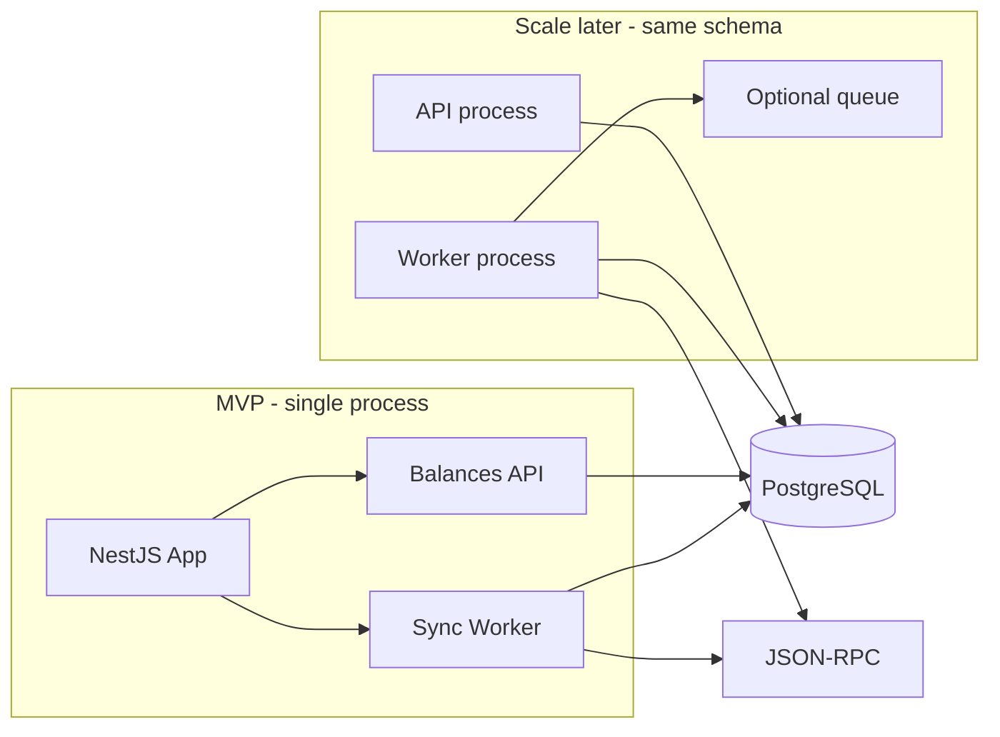
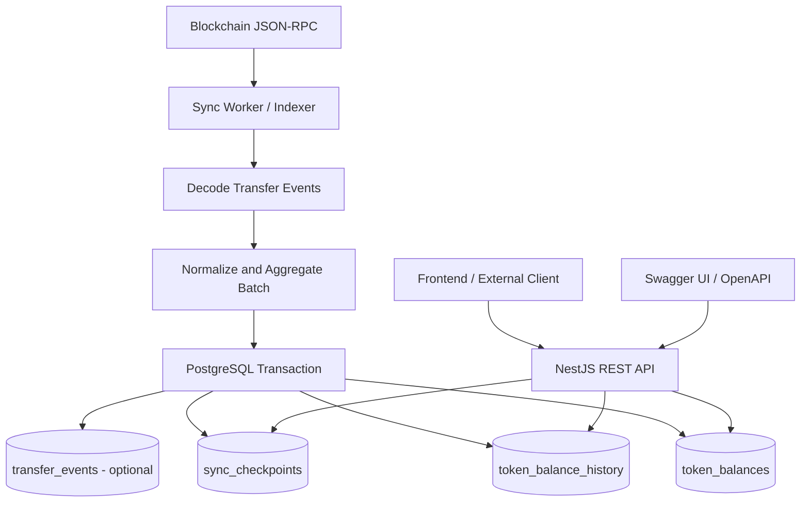

# ERC-20 Holder Balance Indexer

## 1. Tổng quan

### Mục tiêu

Xây dựng service đồng bộ holder balance ERC-20 (ví dụ USDC) từ blockchain vào PostgreSQL, kèm Swagger API để truy vấn:

- Balance hiện tại của một địa chỉ.
- Lịch sử thay đổi balance theo từng `Transfer` event.
- Thông tin transaction, block và mức tăng/giảm balance.
- Tiến độ đồng bộ của từng token.

**Nguyên tắc:** ship MVP trong ~3 ngày, nhưng thiết kế seam từ đầu để scale sau (thêm token/chain, tách worker, tăng throughput) mà không phải viết lại schema hoặc luồng sync cốt lõi.

### Công nghệ (chốt)

- **Backend:** NestJS + TypeScript
- **Database:** PostgreSQL
- **ORM:** TypeORM + migrations (`synchronize: false`)
- **API docs:** Swagger / OpenAPI (`@nestjs/swagger`)
- **Blockchain:** `viem` + EVM JSON-RPC

### Phạm vi theo giai đoạn

| | Trong 3 ngày (MVP) | Scale sau (giữ seam sẵn) |
| --- | --- | --- |
| Chain / token | 1 chain + 1 token (seed qua env) | Nhiều token / nhiều chain qua bảng `tokens` |
| Process | API + worker chung 1 NestJS process | Tách worker process / queue, cùng DB schema |
| Reorg | Chỉ sync tới `head - confirmationDepth` | Rollback/replay theo `block_hash` |
| Raw events | Không bắt buộc | Thêm `transfer_events` khi cần audit/replay |
| Pagination | `limit` + cursor đơn giản | Keyset ổn định khi history lớn |
| Partition | Không | Partition history theo block/time khi đủ lớn |

> Lưu ý: Không phải token ERC-20 nào cũng suy ra balance đúng chỉ từ Transfer. Token rebasing / balance đặc biệt cần reconciliation riêng (Phase 2+).

---

## 1.1. Nguyên tắc scale-ready (làm ngay từ MVP)

Làm đúng các điểm này ngay từ đầu; **không** cần build hết Phase 2/3 trong 3 ngày:

1. **Schema đa chiều:** mọi bảng chính khóa theo `(chain_id, token_address, ...)`. MVP chỉ seed 1 token nhưng schema đã sẵn multi-token/multi-chain.
2. **Tách module rõ:** `blockchain` (RPC) / `sync` (indexer) / `balances` (read API) / `tokens` (metadata). Sau này tách worker = bật module `sync` ở process khác, không đụng API.
3. **Idempotent write path:** unique key theo event + apply balance đúng 1 lần trong DB transaction. Đây là nền để retry / multi-worker an toàn sau này.
4. **Checkpoint per token:** `sync_checkpoints` theo `(chain_id, token_address)` — scale ngang theo token mà không đụng checkpoint chung.
5. **NUMERIC + string API:** tránh rewrite precision khi volume tăng.
6. **Config qua env:** RPC, batch size, confirmation depth, poll interval — tune throughput không đổi code.
7. **API chỉ đọc DB:** không gọi RPC trên hot path; sau này thêm cache/read replica không phá contract.
8. **Feature flag process:** `SYNC_ENABLED=true|false` để cùng codebase chạy API-only hoặc worker-only.

**Cố tình chưa làm trong MVP (tránh over-engineer):** queue (Bull/Kafka), distributed lock, partition, multi-RPC failover phức tạp, metrics stack đầy đủ, Top holders nếu đề không bắt buộc.

---

## 2. Đề bài

Cho một ERC-20 token, ví dụ USDC, cần xây dựng hệ thống theo dõi balance của từng holder.

Hệ thống phải giải quyết các yêu cầu:

1. Đọc các `Transfer` event từ blockchain theo block range.
2. Xác định thay đổi balance của địa chỉ gửi và địa chỉ nhận.
3. Lưu balance hiện tại để API có thể truy vấn nhanh.
4. Lưu lịch sử để xem balance đã thay đổi như thế nào theo thời gian.
5. Không ghi trùng event khi worker retry.
6. Không cập nhật balance hai lần nếu một batch được xử lý lại.
7. Lưu checkpoint để tiếp tục sync sau khi service restart.
8. Có chiến lược xử lý RPC timeout / rate limit; reorg tối thiểu bằng `confirmationDepth` (rollback đầy đủ để Phase 2).
9. Cung cấp Swagger API để kiểm thử và tích hợp.
10. Đảm bảo giá trị token chính xác, không dùng floating point cho số dư on-chain.

### Các truy vấn chính

**MVP**

- Lấy balance hiện tại của một holder.
- Lấy lịch sử balance của holder theo thứ tự thời gian (có `limit` / cursor).
- Lấy tiến độ sync của token.
- Lấy metadata token đang theo dõi.

**Scale sau / optional**

- Lọc lịch sử theo khoảng block hoặc thời gian.
- Top holders (`ORDER BY balance DESC` + index phụ khi cần).
- Admin: thêm token / trigger resync qua API.

---

## 3. Kiến trúc hệ thống

### 3.0. MVP (1 process) vs Scale (tách process)



Cùng schema + cùng module boundary → scale bằng cách tách deploy / bật `SYNC_ENABLED`, không redesign.

### 3.1. Luồng dữ liệu



### Các thành phần

#### 3.2. Blockchain RPC

- Đọc block và `Transfer` logs theo block range.
- Lấy timestamp và block hash cho các event.
- Giới hạn block range theo giới hạn của provider (`SYNC_BLOCK_RANGE`).
- Retry có exponential backoff khi gặp lỗi tạm thời (timeout, 429).
- **Scale sau:** thêm RPC fallback list / provider pool mà không đổi contract của `TransferLogReader`.

#### 3.3. Sync Worker / Indexer

Worker có nhiệm vụ:

1. Đọc checkpoint hiện tại (theo token).
2. Xác định block range tiếp theo; safe head = `latest - confirmationDepth`.
3. Lấy log từ RPC.
4. Sắp xếp log theo `blockNumber`, `transactionIndex`, `logIndex`.
5. Decode và chuẩn hóa địa chỉ (lowercase).
6. Tính delta cho từng holder.
7. Ghi history, cập nhật current balance và checkpoint trong **một** DB transaction.
8. Chỉ đánh dấu range hoàn tất sau khi commit thành công.

MVP: một worker loop tuần tự cho các token `enabled`. Không chạy song song cùng token nếu chưa có lock.

**Scale sau:** một worker process per token / per chain; hoặc queue job theo `(chainId, tokenAddress, fromBlock, toBlock)`.

#### 3.4. PostgreSQL

- `tokens`: metadata + `deployment_block` / start block.
- `token_balances`: số dư hiện tại.
- `token_balance_history`: lịch sử theo event.
- `sync_checkpoints`: tiến độ sync.
- `transfer_events` (Phase 2): raw log cho replay / audit / reorg.

#### 3.5. NestJS API

API chỉ phục vụ truy vấn dữ liệu đã đồng bộ; không gọi RPC cho request đọc balance thông thường.

Swagger qua `@nestjs/swagger` tại `/docs`.

---

## 4. Thiết kế database

### 4.1. Nguyên tắc

- Mỗi token: `chain_id + token_address`.
- Mỗi holder: `chain_id + token_address + holder_address`.
- Chuẩn hóa địa chỉ về lowercase nếu dùng `VARCHAR`.
- Balance lưu raw integer unit; không chia `10 ** decimals` trong DB.
- Dùng `NUMERIC`, không dùng `FLOAT` / `REAL`.
- API trả raw amount dạng string.
- `decimals` / `symbol` nằm ở bảng `tokens`.

### 4.2. Bảng `tokens`

```sql
CREATE TABLE tokens (
    chain_id          INTEGER NOT NULL,
    token_address     VARCHAR(42) NOT NULL,
    symbol            VARCHAR(32),
    name              VARCHAR(128),
    decimals          SMALLINT,
    deployment_block  BIGINT NOT NULL,
    enabled           BOOLEAN NOT NULL DEFAULT TRUE,
    created_at        TIMESTAMPTZ NOT NULL DEFAULT NOW(),
    updated_at        TIMESTAMPTZ NOT NULL DEFAULT NOW(),

    PRIMARY KEY (chain_id, token_address)
);
```

MVP: seed 1 row từ env lúc bootstrap. Scale: thêm token bằng insert / admin API sau.

### 4.3. Bảng `token_balances`

```sql
CREATE TABLE token_balances (
    chain_id          INTEGER NOT NULL,
    token_address     VARCHAR(42) NOT NULL,
    holder_address    VARCHAR(42) NOT NULL,
    balance           NUMERIC(78, 0) NOT NULL,
    updated_block     BIGINT NOT NULL,
    updated_log_index INTEGER,
    updated_at        TIMESTAMPTZ NOT NULL DEFAULT NOW(),

    PRIMARY KEY (chain_id, token_address, holder_address),
    CHECK (balance >= 0)
);
```

Ghi chú:

- Lookup balance theo PK là đủ cho MVP.
- Có thể xóa row khi balance = 0; API hiểu thiếu row = 0. Nếu cần “mọi holder từng xuất hiện”, giữ row balance 0.
- **Scale — Top holders:** thêm index khi thật sự cần:

```sql
CREATE INDEX idx_token_balances_top
ON token_balances (chain_id, token_address, balance DESC);
```

### 4.4. Bảng `token_balance_history`

Một Transfer thường tạo tối đa 2 row (sender + receiver). Mint/burn với zero address có quy tắc riêng.

```sql
CREATE TABLE token_balance_history (
    id                BIGINT GENERATED ALWAYS AS IDENTITY PRIMARY KEY,
    chain_id          INTEGER NOT NULL,
    token_address     VARCHAR(42) NOT NULL,
    holder_address    VARCHAR(42) NOT NULL,

    block_number      BIGINT NOT NULL,
    block_hash        VARCHAR(66) NOT NULL,
    block_timestamp   TIMESTAMPTZ NOT NULL,
    transaction_index INTEGER NOT NULL,
    tx_hash           VARCHAR(66) NOT NULL,
    log_index         INTEGER NOT NULL,

    balance_before    NUMERIC(78, 0) NOT NULL,
    balance_after     NUMERIC(78, 0) NOT NULL,
    delta             NUMERIC(80, 0) NOT NULL,

    created_at        TIMESTAMPTZ NOT NULL DEFAULT NOW(),

    UNIQUE (chain_id, tx_hash, log_index, holder_address)
);
```

```sql
CREATE INDEX idx_balance_history_holder_order
ON token_balance_history (
    chain_id,
    token_address,
    holder_address,
    block_number DESC,
    transaction_index DESC,
    log_index DESC
);

-- Optional khi cần query/reorg theo block
CREATE INDEX idx_balance_history_block
ON token_balance_history (
    chain_id,
    token_address,
    block_number
);
```

`delta` dùng `NUMERIC(80,0)` để an toàn hơn với hiệu có dấu gần giới hạn `uint256`.

### 4.5. Bảng `sync_checkpoints`

```sql
CREATE TABLE sync_checkpoints (
    chain_id             INTEGER NOT NULL,
    token_address        VARCHAR(42) NOT NULL,
    last_processed_block BIGINT NOT NULL,
    last_block_hash      VARCHAR(66),
    updated_at           TIMESTAMPTZ NOT NULL DEFAULT NOW(),

    PRIMARY KEY (chain_id, token_address)
);
```

Không cập nhật checkpoint trước khi balance/history commit thành công.

### 4.6. Bảng `transfer_events` (Phase 2 — optional)

Bật khi cần replay, audit, hoặc reorg dễ hơn. **Không bắt buộc MVP.**

```sql
CREATE TABLE transfer_events (
    chain_id          INTEGER NOT NULL,
    token_address     VARCHAR(42) NOT NULL,
    block_number      BIGINT NOT NULL,
    block_hash        VARCHAR(66) NOT NULL,
    transaction_index INTEGER NOT NULL,
    tx_hash           VARCHAR(66) NOT NULL,
    log_index         INTEGER NOT NULL,
    from_address      VARCHAR(42) NOT NULL,
    to_address        VARCHAR(42) NOT NULL,
    value             NUMERIC(78, 0) NOT NULL,
    created_at        TIMESTAMPTZ NOT NULL DEFAULT NOW(),

    PRIMARY KEY (chain_id, tx_hash, log_index)
);

CREATE INDEX idx_transfer_events_block
ON transfer_events (chain_id, token_address, block_number);
```

---

## 5. Luồng xử lý Transfer event

Ví dụ `Transfer(A, B, 100)` với A=500, B=200 trước event:

- A: before=500, delta=-100, after=400
- B: before=200, delta=+100, after=300

### Quy trình một block range

1. Lấy logs trong `[from, to]`, với `to <= latest - confirmationDepth`.
2. Sort theo `block_number`, `transaction_index`, `log_index`.
3. Decode event.
4. Xác định sender / receiver (mint/burn/self-transfer).
5. Đọc balance hiện tại của holder bị tác động (trong transaction, có thể `SELECT ... FOR UPDATE` khi scale multi-writer).
6. Tính `balance_before`, `delta`, `balance_after`.
7. Insert history (ON CONFLICT DO NOTHING / fail-and-skip nếu đã có — quy tắc idempotent rõ ràng).
8. Update current balance **chỉ khi** history mới được ghi.
9. Update checkpoint + `last_block_hash`.
10. Commit.

### Chống duplicate và retry

Unique trên history **chưa đủ** nếu vẫn cộng balance khi conflict. Chọn một quy tắc và giữ xuyên suốt:

- Insert history trước; chỉ apply balance khi insert thành công (row mới).
- Hoặc ghi raw event unique trước (Phase 2), rồi apply balance theo event mới.

Batch lỗi → rollback toàn bộ → retry. Không commit checkpoint sớm.

### Edge cases

- Mint: `from` = zero address.
- Burn: `to` = zero address.
- Self-transfer: delta ròng = 0; tránh double-apply sai.
- Nhiều Transfer cùng holder trong 1 block: giữ thứ tự log; history event-level.
- Reorg (MVP): tránh bằng `confirmationDepth`. Phase 2: so `block_hash`, rollback từ block lệch rồi replay.

---

## 6. Tối ưu read/write

### Read: current balance

```sql
SELECT balance, updated_block
FROM token_balances
WHERE chain_id = $1
  AND token_address = LOWER($2)
  AND holder_address = LOWER($3);
```

### Read: lịch sử

```sql
SELECT
    block_number,
    block_timestamp,
    tx_hash,
    log_index,
    balance_before,
    balance_after,
    delta
FROM token_balance_history
WHERE chain_id = $1
  AND token_address = LOWER($2)
  AND holder_address = LOWER($3)
ORDER BY block_number DESC, transaction_index DESC, log_index DESC
LIMIT $4;
```

MVP: cursor đơn giản dựa trên `(block_number, transaction_index, log_index)`. Scale: keyset pagination, tránh `OFFSET` cao.

### Write

- Batch vài trăm–vài nghìn log; tune bằng `SYNC_BLOCK_RANGE`.
- Bulk insert history.
- Aggregate delta cho current balance trong batch **sau khi** đã tạo history đúng thứ tự.
- MVP: 1 worker tuần tự. Scale: giới hạn concurrency theo token + row lock.

### Partitioning

Chưa cần lúc đầu. Khi history rất lớn, partition theo block/time; thiết kế unique constraint tương thích partition key.

---

## 7. Cấu trúc dự án NestJS

```text
src/
├── app.module.ts
├── main.ts
├── config/
│   ├── configuration.ts
│   └── validation.ts
├── database/
│   ├── database.module.ts
│   └── migrations/
├── blockchain/
│   ├── blockchain.module.ts
│   ├── rpc.client.ts
│   ├── transfer-log.reader.ts
│   └── abi/
│       └── erc20.abi.ts
├── tokens/
│   ├── tokens.module.ts
│   ├── tokens.controller.ts
│   ├── tokens.service.ts
│   ├── dto/
│   └── entities/
│       └── token.entity.ts
├── balances/
│   ├── balances.module.ts
│   ├── balances.controller.ts
│   ├── balances.service.ts
│   ├── dto/
│   └── entities/
│       ├── token-balance.entity.ts
│       └── token-balance-history.entity.ts
├── sync/
│   ├── sync.module.ts
│   ├── sync.service.ts
│   ├── sync.worker.ts
│   ├── checkpoint.service.ts
│   └── dto/
└── common/
    ├── filters/
    ├── interceptors/
    ├── pipes/
    └── utils/
```

### Trách nhiệm module

| Module | MVP | Scale path |
| --- | --- | --- |
| `blockchain` | 1 RPC client | Provider pool / failover |
| `sync` | Loop trong cùng process (`SYNC_ENABLED`) | Process riêng / queue jobs |
| `tokens` | Seed 1 token từ env | CRUD nhiều token |
| `balances` | Read API | Cache / read replica |
| `database` | Migrations | Partition / connection pool tune |

Không bật `synchronize: true` ở môi trường thật.

### Bootstrap gợi ý

- `SYNC_ENABLED=true`: start worker sau khi app listen.
- `SYNC_ENABLED=false`: API-only (chuẩn bị scale horizontal cho read).

---

## 8. Swagger REST API

Base path: `/api/v1`

| Method | Endpoint | MVP | Ghi chú |
| --- | --- | --- | --- |
| `GET` | `/health` | Có | Liveness |
| `GET` | `/tokens` | Có | Danh sách token |
| `GET` | `/tokens/:chainId/:tokenAddress` | Có | Metadata |
| `GET` | `/tokens/:chainId/:tokenAddress/holders/:holderAddress/balance` | Có | Balance hiện tại |
| `GET` | `/tokens/:chainId/:tokenAddress/holders/:holderAddress/history` | Có | Lịch sử + cursor |
| `GET` | `/tokens/:chainId/:tokenAddress/sync-status` | Có | Checkpoint / lag |
| `GET` | `/tokens/:chainId/:tokenAddress/holders/top` | Optional | Scale / nếu đề yêu cầu |
| `POST` | `/tokens` | Optional | Admin thêm token |
| `POST` | `/tokens/:chainId/:tokenAddress/sync` | Optional | Admin resync |

### Ví dụ: current balance

```json
{
  "chainId": 1,
  "tokenAddress": "0xTOKEN",
  "holderAddress": "0xAAA",
  "balanceRaw": "1500000",
  "decimals": 6,
  "balanceFormatted": "1.5",
  "updatedBlock": "22000000"
}
```

`balanceRaw` / block number trả string. `balanceFormatted` dùng decimal-safe formatter.

### Ví dụ: history

```json
{
  "items": [
    {
      "blockNumber": "22000000",
      "timestamp": "2026-10-09T12:00:00Z",
      "txHash": "0x...",
      "logIndex": 3,
      "deltaRaw": "500000",
      "balanceBeforeRaw": "1000000",
      "balanceAfterRaw": "1500000"
    }
  ],
  "nextCursor": null
}
```

### Swagger bootstrap

```typescript
import { NestFactory } from '@nestjs/core';
import { SwaggerModule, DocumentBuilder } from '@nestjs/swagger';
import { AppModule } from './app.module';

async function bootstrap() {
  const app = await NestFactory.create(AppModule);

  const config = new DocumentBuilder()
    .setTitle('ERC-20 Balance Indexer API')
    .setDescription(
      'API for current ERC-20 holder balances, balance history, and sync status.',
    )
    .setVersion('1.0.0')
    .addTag('Tokens')
    .addTag('Balances')
    .addTag('Sync')
    .build();

  const document = SwaggerModule.createDocument(app, config);
  SwaggerModule.setup('docs', app, document);

  await app.listen(process.env.PORT ?? 3000);
}

bootstrap();
```

---

## 9. Bảo đảm tính chính xác

### Thứ tự event

Sort theo `block_number` → `transaction_index` → `log_index`.

### Sync an toàn

- **MVP:** chỉ index tới `head - SYNC_CONFIRMATION_DEPTH`; lưu `last_block_hash`.
- **Phase 2:** nếu hash tại checkpoint không còn canonical → rollback từ block lệch → replay.
- Ghi balance + history + checkpoint trong cùng transaction.

### Đối soát (Phase 2)

Định kỳ so sánh một số holder với `balanceOf(holder)` tại block đã confirmed. Danh sách holder lấy từ event/DB, không từ `balanceOf`.

---

## 10. Cấu hình môi trường

Thiết kế env để MVP chạy được ngay và scale bằng cách thêm biến / tách process, không đổi schema.

```dotenv
# App
NODE_ENV=development
PORT=3000

# Process role — scale: API replica đặt SYNC_ENABLED=false
SYNC_ENABLED=true

# PostgreSQL
DATABASE_HOST=localhost
DATABASE_PORT=5432
DATABASE_USER=postgres
DATABASE_PASSWORD=postgres
DATABASE_NAME=indexer

# RPC (viem)
RPC_URL=https://eth-mainnet.g.alchemy.com/v2/YOUR_KEY
# Scale sau (optional):
# RPC_URL_FALLBACK=https://...

# Seed token MVP (1 token). Scale: thêm row vào bảng tokens
CHAIN_ID=1
TOKEN_ADDRESS=0xa0b86991c6218b36c1d19d4a2e9eb0ce3606eb48
TOKEN_SYMBOL=USDC
TOKEN_NAME=USD Coin
TOKEN_DECIMALS=6
# Dùng block gần đây để demo kịp; production: deployment/start block đã xác minh
SYNC_START_BLOCK=22000000

# Sync tuning — tăng/giảm để scale throughput
SYNC_BLOCK_RANGE=500
SYNC_CONFIRMATION_DEPTH=12
SYNC_POLL_INTERVAL_MS=5000
SYNC_RETRY_MAX_ATTEMPTS=5
SYNC_RETRY_BASE_DELAY_MS=1000
```

| Biến | Bắt buộc MVP | Mục đích |
| --- | --- | --- |
| `DATABASE_*` | Có | Postgres |
| `RPC_URL` | Có | `eth_getLogs` / block |
| `CHAIN_ID`, `TOKEN_*`, `SYNC_START_BLOCK` | Có | Seed 1 token |
| `SYNC_BLOCK_RANGE` | Có | Kích thước batch |
| `SYNC_CONFIRMATION_DEPTH` | Có | Giảm reorg MVP |
| `SYNC_POLL_INTERVAL_MS` | Có | Poll khi bắt kịp head |
| `SYNC_ENABLED` | Nên có | Tách API / worker sau này |
| `SYNC_RETRY_*` | Nên có | Backoff RPC |
| `RPC_URL_FALLBACK` | Không | Scale reliability |

Không commit `.env` có secret. Validate env lúc boot (`Joi` / `zod` / `class-validator`).

**Lưu ý demo 3 ngày:** đừng để `SYNC_START_BLOCK` quá xa head trên mainnet (USDC từ đầu sẽ sync rất lâu). Chọn cửa sổ vài nghìn–vài chục nghìn block, hoặc Anvil + token local.

---

## 11. Kiểm thử

### MVP (ưu tiên)

1. Decode đúng ERC-20 Transfer.
2. Sender trừ / receiver cộng đúng.
3. Mint, burn, self-transfer.
4. Nhiều event cùng holder trong 1 block.
5. Retry cùng batch không double-apply balance.
6. Rollback DB khi batch lỗi giữa chừng.
7. Checkpoint chỉ tiến sau commit.
8. API history đúng thứ tự + precision (số lớn dạng string).

### Phase 2+

9. Reorg detect + replay.
10. Reconciliation với `balanceOf()`.
11. Multi-token checkpoint độc lập.
12. API-only process với `SYNC_ENABLED=false`.

---

## 12. Kế hoạch 3 ngày + đường scale

### Day 1 — Nền tảng

- NestJS + TypeORM + Postgres (Docker Compose).
- Migrations: `tokens`, `token_balances`, `token_balance_history`, `sync_checkpoints`.
- Config/env validation + seed 1 token.
- `blockchain`: RPC client + đọc Transfer logs theo range.

### Day 2 — Sync đúng

- Worker: checkpoint → fetch → decode → apply idempotent trong transaction.
- Xử lý mint/burn/self-transfer + retry backoff.
- `confirmationDepth` safe head.
- Đơn giản: chạy sync một cửa sổ block gần đây để có data demo.

### Day 3 — API + hoàn thiện

- Balance / history / sync-status / tokens + Swagger.
- `GET /health`.
- Test case cốt lõi + README chạy local.
- (Optional nếu còn giờ) Top holders hoặc `transfer_events`.

### Phase 2 — Reliability (sau đề)

- `transfer_events` + reorg rollback/replay.
- Reconciliation `balanceOf`.
- Structured logs / metrics / lag alert.
- Worker lock theo token.

### Phase 3 — Scale

- `SYNC_ENABLED` tách API/worker deploy.
- Queue theo block range / per-token worker.
- Benchmark batch size; connection pool.
- Keyset pagination cứng; partition history khi đủ lớn.
- Multi-RPC fallback; nhiều chain.

---

## 13. Quyết định kiến trúc mặc định

| Hạng mục | MVP (3 ngày) | Scale path |
| --- | --- | --- |
| Backend | NestJS monolith (API + worker) | Tách process cùng codebase |
| Database | PostgreSQL | Read replica / partition sau |
| ORM | TypeORM + migrations | Không đổi |
| Chain lib | `viem` | Provider pool |
| Current balance | `token_balances` | + index top holders nếu cần |
| History | `token_balance_history` event-level | Partition / retention |
| Sync progress | `sync_checkpoints` per token | Multi-worker per token |
| Raw events | Bỏ qua | `transfer_events` |
| Write | Batch + TX + idempotency | Queue + lock |
| Read | PK lookup + holder index | Cache / replica |
| Pagination | Limit + cursor đơn giản | Keyset |
| Precision | `NUMERIC` + string API | Không đổi |
| Reorg | `confirmationDepth` | Hash check + rollback |
| Deploy | Docker Compose | API replicas + worker replicas |

**Kết luận:** Trong 3 ngày, implement 1 process + 1 token + 4 bảng chính, nhưng **giữ khóa `(chain_id, token_address)`, module tách, write idempotent, checkpoint per token, và `SYNC_ENABLED`**. Đó là đường ngắn nhất để demo đúng, đồng thời mở rộng multi-token / tách worker / tăng throughput mà không redesign.
